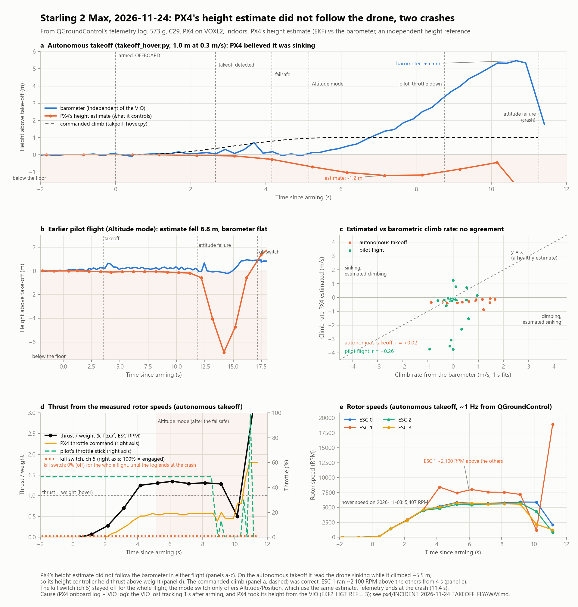

# Incident report: autonomous takeoff fly-away and crash (2026-11-24)

**Vehicle:** Starling 2 Max (VOXL 2, PX4, VIO-based position)
**Outcome:** frame damaged on impact; onboard electronics OK; no injuries.
**Status:** root cause found (see **Root cause**): the VIO lost tracking, and PX4, configured to take
its height from the VIO, kept flying on a stale estimate. The script's abort then fell through to
Altitude mode, which used the same estimate.
**Sources:** QGroundControl telemetry log `2026-11-24 14-55-05.tlog`; PX4's onboard logs
`flight_logs/2026-11-24/drone/px4_logs/21_49_16.ulg` (autonomous) and `21_49_43.ulg` (pilot); the VIO
log (`drone/vlog_flight_05ms_0*/`); the takeoff script's log (`drone/takeoff_03/`).

## Summary

During the first autonomous takeoff (`px4/takeoff_hover.py`, 1.0 m climb at 0.3 m/s), the drone did
not stop at 1 m: it climbed to about 5.5 m and crashed. **The VIO (qvio) lost tracking one second
after arming, while the motors were spooling up on the ground.** PX4 was configured to take its height
from the VIO (`EKF2_HGT_REF = 3`), so its height estimate stopped following the drone: it believed the
drone had barely moved, then that it was sinking (to 1.2 m *below the floor*), while the barometer
showed it climbing. To reach the setpoint, then to "stop sinking", PX4 kept thrust above the drone's
weight. The script noticed the estimate wasn't following and aborted at 3.1 s, but PX4 never took its
Hold request; its offboard-loss failsafe switched to Altitude mode instead, which uses the same height.
The pilot-flown crash earlier the same day was the same failure: the VIO lost tracking 8.5 s into that
flight.

*Figure: `flight_logs/2026-11-24/plot_takeoff_incident.py` on the telemetry log (copied to
`flight_logs/2026-11-24/qgc_2026-11-24_14-55-05.tlog`). Thrust uses k_f = 4.383e-6 N/(rad/s)² from
the 2026-11-03 hover identification. QGroundControl's default rates are coarse (~1 Hz for RPM and the
position estimate, ~4 Hz for the barometer).*

## Timeline (seconds after arming)

| t (s) | PX4 height estimate | Barometer | Event |
|---|---|---|---|
| −1.0 | on the floor | on the floor | VIO tracking OK but weak: quality 50, 21 features |
| 0.0 | on the floor | on the floor | Armed by the script, OFFBOARD (0.1 s); motors spooling up |
| 1.0 | on the floor | on the floor | **VIO loses tracking:** features 22 → 5, quality 50 → 1 (drone still on the ground) |
| 2.0 | — | — | **VIO resets** (state 0, quality −1) and never recovers; PX4 keeps fusing vision |
| 2.7 | at the floor | at the floor | "Takeoff detected" |
| 3.1 | 0.0 m (setpoint 0.5 m) | +0.4 m | **Script aborts**: estimate 0.5 m from its setpoint; sends Hold once, stops streaming |
| 4.1 | 0.2 m below start, sinking | rising | **"Failsafe activated": `offboard_control_signal_lost`** (PX4 never entered Hold) |
| 4.5 | — | — | PX4 stops fusing the VIO; height from the barometer only (`EKF2_BARO_NOISE` 3 m, slow) |
| 5.1 | 0.7 m below, sinking | +0.1 m | Failsafe action `COM_OBL_RC_ACT = 1`: **Altitude mode** |
| 7.2 | **1.2 m below the floor** | +1.4 m | thrust stays ~1.3× weight |
| 8.4 | — | ~+3 m | PX4 marks its horizontal position invalid |
| 8.8–9.0 | 0.8 m below | +3.7 m | pilot pulls the throttle stick to minimum |
| 10.2 | 0.5 m below | **+5.3 m** (peak +5.5 m at 10.7 s) | |
| 10.9 | — | falling | PX4 throttle reaches 60% |
| 11.3 | — | — | "Attitude failure (roll)": crash |

## Findings

- **Height estimate wrong.** On the autonomous takeoff the estimate moved down while the barometer
  moved up (~5.5 m in 9 s). Climb rates from the two don't correlate in either flight (r ≈ 0, panel c).
- **Thrust stayed above weight.** From the ESC speeds, thrust was 1.25–1.35× the drone's weight from
  4 s to 9 s (panel d): a sustained climb that PX4's controller kept commanding.
- **Earlier pilot flight: same kind of fault.** In that Altitude-mode flight (before the recalibration),
  PX4 claimed the drone was falling, down to 6.8 m below the start, while the barometer barely moved.
  It also ended in "Attitude failure (roll)". The gyro, accelerometer and level recalibration did not fix it.
- **One rotor ran fast.** ESC 1 spun ~2,100 RPM above the other three from 4 s on (panel e). This
  could be the attitude controller compensating for something (a damaged prop, a motor, or the drift
  after the horizontal position was lost); it needs checking before the next flight.
- **Why the RC "didn't respond".** The RC link was solid throughout (all 16 channels, RSSI 255), and the
  pilot's throttle-down is in the log. But Altitude and Position modes both use the same wrong height,
  so "descend" became more thrust. Only Stabilized/Manual mode or the kill switch bypass the estimate,
  and neither was used during this flight (see **Kill switch and RC takeover** below).
- **The script's commands were correct, and its abort fired, but the hand-off failed.** It asked for
  the right climb. At 3.1 s PX4's estimate had moved 0.007 m against a 0.51 m setpoint, so it aborted
  and sent Hold. That was a **single, unacknowledged** command; PX4 stayed in OFFBOARD with no
  setpoints, and 1 s later its offboard-loss failsafe chose **Altitude** (`COM_OBL_RC_ACT = 1`), which
  flies on the same bad height. (Hold would have too; see **Root cause**.)
- **Estimator warnings before arming.** "Yaw estimate error" and "heading estimate not stable" appeared
  repeatedly during the session before the flight.

## Kill switch and RC takeover

**How the transmitter is set up** (read from the RC channels in the log):

| Channel | Function | Positions |
|---|---|---|
| 3 | throttle | 1000–2000 |
| 5 | **kill switch** | 1011 off, 1988 **engaged**: it flips at all 9 "Kill-switch engaged" messages in the log |
| 6 | flight-mode switch | 1011 **Altitude**, 1500 **Position**, 1988 **Offboard** |

**The kill switch works.** It was toggled on the bench several times during the session, the last time
98 s before the autonomous arm (engaged, then released 0.9 s later). In the earlier pilot flight it
ended the flight: "Kill-switch engaged" → "Disarmed by kill-switch" in 0.3 s, about 5 s after the
attitude failure.

**In the autonomous flight it was never engaged.** For the full 11.4 s the log covers:
- Channel 5 (kill) stayed at 1011 (off).
- Channel 6 (mode switch) stayed at 1500 (Position). It was never moved, so PX4's own failsafe made
  the only mode change, to Altitude at 5.1 s.
- Only the throttle stick moved. It left center at 8.8 s and was at minimum from 9.0 s, apart from
  two single 5 Hz samples near the end (1300 at 10.6 s, and full throttle, 1986, at 11.0 s, as the
  drone came down).
- The RC link itself was solid: RSSI 255 throughout.

**Telemetry ends at 11.4 s, right at the crash,** and so does PX4's onboard log (`21_49_16.ulg`, 11.4 s):
power was lost on impact, so nothing after it was recorded anywhere.

**Why the kill switch was the only way out.** With PX4's height estimate wrong, every control that
goes through it made things worse or did nothing:
- **Mode switch:** its only positions besides Offboard are **Altitude and Position**, and both hold
  the same wrong height. There is no Stabilized or Manual position on the switch, so the pilot had no
  switch position that bypassed the estimate.
- **Throttle stick:** in Altitude mode it asks for a climb rate *relative to the estimate*; at
  minimum it asks to descend, which PX4 answered with more thrust.
- **The script's abort:** it did fire (the estimate wasn't following its setpoint), but it can only
  hand PX4 to another mode, and every automatic mode uses the same estimate. A geofence would too.

**The trade-off.** Killing the motors drops the drone from wherever it is. The barometer shows it
passing 1 m (its target) at ~6.9 s and 2 m at ~7.9 s, versus the ~5.5 m it reached. A kill at the
first sign it was not stopping would have meant a 1–2 m drop instead of an impact from ~5.5 m.

**What to change:**
1. **Put Stabilized (or Manual) on the mode switch,** e.g. in place of Altitude at 1011, so there is a
   takeover position that does not depend on the position or height estimate. Keep Offboard on it.
2. **Kill-switch rule for every autonomous test:** the pilot's finger rests on the kill switch for the
   whole run. If the drone passes its target height, drifts, or does anything unexpected and doesn't
   respond to the mode switch within about a second, kill it. Agree on the rule before arming.
3. **Bench-test the kill switch before each flight** (already done in this session), and include a
   low-height kill in the takeover drill.
4. **Record PX4's onboard log and raise QGroundControl's telemetry rates,** so the moments after an
   incident are captured too.

## Root cause (from PX4's onboard logs and the VIO log)

PX4's log and the VIO log share the drone's clock, so they line up directly.

**1. The VIO lost tracking, in both flights.**

| | Before | Loss | After |
|---|---|---|---|
| Autonomous | quality 50, ~21 features | **1.0 s after arming, on the ground during spool-up:** features 22 → 5, quality 50 → 1 | state 0 (reset) from 2.0 s, quality −1, never recovered |
| Pilot | quality 95, ~20 features | **8.5 s after arming**, right after a 7° pitch: quality 51 | state 0 from 9.0 s, never recovered |

The qvio output didn't report a descent; it stopped tracking. The autonomous flight started with a
weaker VIO (quality 50 vs 95), and it failed before liftoff, so vibration at spool-up or the view from
where it sat are suspects; the logs can't say which.

**2. PX4 was set to take its height from the VIO.** At the time: `EKF2_HGT_REF = 3` (vision) and
`EKF2_EV_CTRL = 15` (vision position, height, velocity and yaw), with the barometer weighted very
lightly (`EKF2_BARO_NOISE = 3.0` m). PX4 kept fusing the vision data for several seconds after the VIO
had reset (until 4.5 s in the autonomous flight, 11.6 s in the pilot flight), so its height stopped
following the drone. When it finally dropped the VIO, the barometer was too lightly weighted to pull
the estimate back quickly. PX4's z was never flagged invalid (`z_valid` stayed true), so nothing in PX4
treated the height as untrustworthy.

**3. Every automatic recovery used that height.** The script's abort, PX4's offboard-loss failsafe
(Altitude), Hold, Position and a geofence all fly on the same estimate. Only the kill switch or a
Stabilized/Manual mode were independent of it.

**Since the crash** (parameters on the drone, 2026-11-25): `EKF2_HGT_REF = 0` (barometer),
`voxl-qvio-server` is off, and PX4 uses the new MTF-02P optical-flow sensor for horizontal position
(`EKF2_OF_CTRL = 1`). That removes this failure path. Two things to watch:
- `EKF2_EV_CTRL` is still 15, so if the VIO is restarted, PX4 will fuse it again.
- On the bench, PX4's barometric height drifted ~1.3 m "upward" over the first ~15 minutes after boot
  (fast at first, then leveling off): let the drone warm up until the height reading is steady before flying.

## Actions before the next flight

0. **Check the motor and prop on ESC 1** (and all props after the impact): spin-up on the bench,
   matching speeds at the same throttle.
1. **Props-off lift test:** with QGroundControl connected, lift the drone ~1 m by hand. The altitude must
   read **up**. Do not fly in any mode (Altitude/Position included) until it does.
2. **Height source:** keep `EKF2_HGT_REF = 0` (barometer, as now). Set `EKF2_EV_CTRL = 0` while the VIO
   is off, so a restarted VIO can't silently become a source again. Wait for the barometric height to
   settle after boot (see **Root cause**).
3. **Transmitter and pilot drill:** add a **Stabilized** position to the mode switch; for unexpected
   behavior, switch to Stabilized or use the **kill switch**, not Position/Altitude. Test the kill
   switch on the bench before each session (see **Kill switch and RC takeover**).
4. **Script safeguards** (to add to `takeoff_hover.py` / `fly_min_snap_offboard.py`):
   - ~~Refuse to arm unless PX4 reports a healthy estimator and its position source (now optical flow)
     is being fused.~~ **Done 2026-11-25** (`px4/preflight.py`, run by both scripts before the confirm
     prompt). On the drone it currently refuses only because `EKF2_EV_CTRL = 13`.
   - ~~On abort, keep streaming a hold setpoint and repeat the mode request until PX4 confirms the new
     mode; never stop streaming with PX4 still in OFFBOARD.~~ **Done 2026-11-25** (`hand_off()` in
     `fly_min_snap_offboard.py`, used by both scripts; tested against a fake PX4 that loses requests).
     The gate script also no longer sends Hold after a pilot takeover.
   - ~~Abort if the estimated height and the barometer disagree in flight.~~ **Done 2026-11-25**
     (`px4/baro_check.py`, used by both scripts in OFFBOARD; preflight also requires the
     `SCALED_PRESSURE` stream it reads). Replayed on the real logs it fires **7.1 s** after arming on
     this crash (the drone ~1.2 m up by the barometer, 4 s before impact), not the ~1.5 s first
     estimated: the barometer is too noisy under prop wash (±0.3 m, ~1 m steps) for a faster check
     without false alarms. It stays quiet on both 2026-11-03 hovers. On abort it hands off to Hold
     and prints a pilot alarm: Hold uses the same wrong height, so the pilot must take over in
     Stabilized or kill. It does **not** catch slow drift (< ~0.25 m/s); preflight's steadiness check
     covers that on the ground.
   - **Added 2026-11-25:** velocity-jump failsafe (`px4/accel_check.py`, both scripts). If PX4's
     velocity changes faster than 3 m/s² beyond the plan's own acceleration for 0.3 s, the flight
     is cancelled and PX4 is handed to **Land** (any abort during such motion also lands). It stays quiet on all three
     2026-11-03 flights. On this crash it would only have fired at 10.4 s (impact 11.3 s): PX4's
     *estimated* velocity looked calm until the end, so the barometer check is the one that matters
     for a wrong estimate; this one is for real violent motion.
5. **Restart autonomy low:** 0.5 m takeoff with `--end land` and the pilot ready, after a clean manual
   hover in Position mode.
