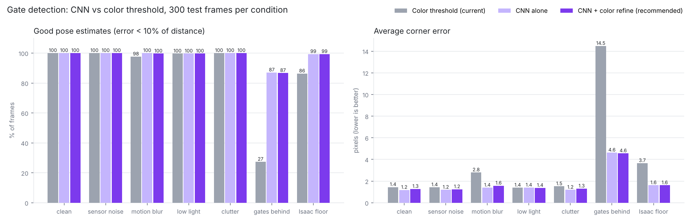

# Gate CNN — vision upgrade for the autonomous drone (Group 1)

Author: Tye Kates. A small convolutional neural network (CNN) that finds the 4 corners of the
nearest gate in the front-camera image. The corners go into the same PnP step the team's
color detector already feeds, giving the gate's 3D position relative to the drone. That
position corrects the gate map live while the drone flies (Tony's GateMap does the correcting).

## Where it fits

```
front camera ──► gate detector ──► 4 corners ──► PnP ──► gate position ──► GateMap ──► planner (min-snap / A*) ──► controller (PID / MPC / RL) ──► PX4
                 (color threshold
                  → CNN, this repo)
```

Only the detector box changes. Everything downstream stays the same.

## Why a CNN if color thresholding already works in Isaac

In a clean Isaac frame (one purple gate, pure black background), color thresholding is
already very accurate, and the results below show that honestly. The CNN earns its place in
the cases where color thresholding breaks:

* **A gate visible through or behind the nearest gate.** The purple blobs merge and the color
  fit grabs the wrong outline. The CNN learned to label only the nearest gate.
* **Motion blur and camera noise.** Edges smear, so the fitted outline shifts.
* **The real drone.** A physical camera in a real room has uneven lighting, reflections and
  color shifts, so a fixed color range will need constant retuning. The CNN is trained on
  randomised lighting, noise, blur and clutter for exactly this reason.

The recommended setup is **CNN + color refine**. The CNN decides which gate it is and roughly
where its corners are. A color fit, restricted to that gate's region, then sharpens each corner
to sub-pixel accuracy, but only if it agrees with the CNN.

## Tested on real Isaac footage (Aaron's stage-4 course recording)

The first version, trained only on black backgrounds, failed on real Isaac frames: the bright
grid floor and the 3D gate boxes were new to it. The renderer now draws an Isaac-style grid floor,
3D gate boxes, and the measured Isaac gate color, and the CNN was retrained on that.

Running `run_on_video.py` on Aaron's recording (`isaac_flight_cnn.mp4`):
* The CNN accepted 26 frames during the flight. In every one, the corners sit on the right gate.
* It correctly refuses frames where the nearest gate is cut off by the frame edge or seen
  edge-on. The color detector in those frames often outlines a partial gate or a farther gate.
* While hovering at the start, the nearest gate is cut off at the top, so the CNN reports
  nothing. (It labels only the nearest gate; it doesn't fall back to a farther, fully visible one.)
* These are screen recordings of the Isaac window, so there's no exact camera matrix and no
  ground truth. This test shows the detections are right, not how many centimetres off they are.
  Saving raw camera frames (see `isaac_live.py`) fixes both.

## Synthetic results (300 unseen test frames per condition)

"Good pose" = PnP gate position within 10% of the distance (within 40 cm at 4 m).

| condition | color threshold (current) | CNN alone | CNN + color refine |
|---|---|---|---|
| clean | 100% | 100% | 100% |
| sensor noise | 100% | 100% | 100% |
| motion blur | 98% | 100% | 100% |
| low light | 100% | 100% | 100% |
| clutter | 100% | 100% | 100% |
| gate visible behind the nearest gate | **27%** | **87%** | **87%** |
| Isaac-style grid floor | 86% | 99% | 99% |

Test gates use the course dimensions: 1.5 m x 1.5 m opening, 0.2 m frame (1.9 m outside).

Median position error in clean frames: color 0.7% of distance, CNN 1.0%, CNN + refine 0.7%.
So the refine step keeps color-level precision on clean frames while keeping the CNN's
robustness. Speed: about 10 ms per frame for the CNN on a laptop CPU in plain NumPy (color
threshold: 0.2 ms), which fits a 30 fps camera loop.



## Files

| file | what it does |
|---|---|
| `config.py` | Gate size, color, camera FOV and resolution. **Set gate size to match Isaac.** |
| `render.py` | Synthetic camera frames (purple gates on black, 60°×36° FOV) with exact ground truth. |
| `nn_numpy.py` | The CNN itself, in plain NumPy (no GPU or PyTorch needed). |
| `train.py` | Trains the CNN. `--real folder/` mixes in labelled Isaac frames. |
| `detector.py` | **Integration API:** `GateCNN.detect()`, `refine_with_color()`, `estimate_pose()`. |
| `baseline.py` | Color-threshold detector used for comparison. |
| `evaluate.py` | Head-to-head test → `results.png`, `examples.png`, `results.json`. |
| `label_isaac.py` | Auto-labels real Isaac frames so the CNN can be fine-tuned on them. |
| `run_on_video.py` | Runs CNN + color detector on a recording or frame folder → annotated video. |
| `isaac_live.py` | Live hook for Isaac: `process_frame()` for gate_vision.py, or a ROS 2 node. |
| `gate_cnn.npz` | Trained weights. |
| `Gate_CNN_demo.ipynb` | Google Colab notebook: upload the zip, run the cells, see the CNN work. |
| `isaac_flight_cnn.mp4` | The CNN run on Aaron's Isaac Sim recording (green = CNN, red = color detector). |

## Quick start

```bash
pip install numpy opencv-python scipy matplotlib
python evaluate.py          # reproduce the comparison
python train.py             # retrain from scratch (~25 min on a laptop CPU)
python run_on_video.py recording.webm --crop 70,58,635,345   # test on an Isaac screen recording
```

## Using it in the Isaac vision loop

```python
from detector import GateCNN, refine_with_color, estimate_pose, good_detection
cnn = GateCNN("gate_cnn.npz")

corners, conf = cnn.detect(frame_bgr)            # TL, TR, BR, BL pixels + confidence per corner
if good_detection(frame_bgr, corners, conf):     # confident, whole gate in view, sides on the gate
    corners = refine_with_color(frame_bgr, corners)
    ok, t_cam, R_cam = estimate_pose(corners, K) # gate centre in camera frame (x right, y down, z fwd)
    # convert t_cam to world with the drone's pose, then hand it to GateMap as today
```

Or call `isaac_live.process_frame(frame_bgr, K)`, which does all of this in one line.
Replace the corner-finding call in `gate_vision.py` with the lines above. `K` is the camera
matrix for your frame resolution (`config.intrinsics(w, h)`).

## Note for integrating with the team's `vision/` code

* **Outer vs inner corners.** The team's `color_gate_detector.py` finds the gate's *inner* opening,
  and `gate_pose.DEFAULT_GATE_SIDE = 1.5` is that opening. This CNN finds the *outer* corners of the
  purple frame, which are 1.9 m apart (1.5 m opening + 0.2 m frame on each side). So when feeding CNN
  corners into `gate_pose.py`, use `gate_model_points(1.9)`, or use this folder's `estimate_pose()`
  (already set to 1.9 m in `config.py`).
* **Corner order** is TL, TR, BR, BL in the image, the same order `gate_pose.order_corners()` produces.
* **Camera frame** is OpenCV's (x right, y down, z forward), the same convention as `vision/camera.py`.

## Next steps (in order)

1. Set `GATE_SIZE_M`, `GATE_BORDER_M` and `GATE_DEPTH_M` in `config.py` to the real Isaac gate
   (ask Aaron or check the track file Tony's spawn_track.py uses).
2. Save a few hundred raw front-camera frames from Isaac (`isaac_live.py --save isaac_raw/`, or
   `run_on_video.py ... --save-frames isaac_raw/` from a recording), run `label_isaac.py`, then fine-tune:
   `python train.py --real isaac_frames/ --init gate_cnn.npz --steps 1500 --lr 5e-4`
3. Swap the detector into `gate_vision.py` and re-fly Tony's camera-gate runs (MPC was 7/9 there).
4. Before the real flight: record a short video from George's drone camera in the test space,
   label ~100 frames the same way, and fine-tune again.

## Limits to be upfront about

* Accuracy numbers are from synthetic frames. On real Isaac footage the detections are correct,
  but centimetre accuracy can't be measured from a screen recording. Step 2 above closes that gap.
* The CNN reports the nearest gate. When that gate is cut off by the frame edge,
  `good_detection()` rejects the frame rather than guess.
* Gate size is set to the simulated course (1.5 m opening + 0.2 m frame = 1.9 m outside). PnP distance scales directly with it, so update config.py if the physical gates differ.
