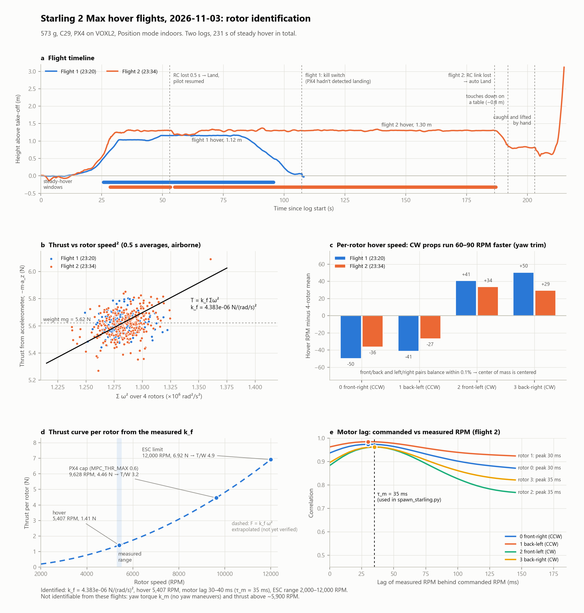

# ModalAI Starling 2 Max (C29) — Dynamics Model

This document gives the physical parameters and equations of motion we use to
simulate our ModalAI **Starling 2 Max, C29 sensor configuration** in Isaac Sim / Pegasus
(`workspace/spawn_starling.py`), and to replace the Iris numbers in the
MPC (`control/`) and RL (`rl/`) stacks. Every number has a source or a
derivation, and every derived number is worked out step by step.

> **Status.**
> - **Mass:** 0.573 kg, **measured** on our C29 drone with both batteries.
> - **Inertia (provisional):** read from CAD with a 500 g whole-assembly mass override (uniform density), then scaled to 573 g (§6.2, §6.4). It will be redone once per-part masses are set in CAD.
> - **Thrust:** $k_f$ is **measured** from two hover flights on 2026-11-03 (§4.4), at real rotor speed. PX4's output-to-RPM mapping and the motor lag come from the same logs (§4.1, §4.2).
> - **Yaw torque (estimated):** $k_m$ is still a propeller-theory estimate (§4.6). The hover flights had no yaw maneuvers.

**Confidence labels used below**

- **(datasheet)**: ModalAI's official Starling 2 Max datasheet or hardware overview.
- **(measured)**: weighed on our drone, or identified from its flight logs.
- **(CAD)**: measured in SolidWorks on ModalAI's STEP model `D0012-4-V3-C28-M36-T7-K0-Starling2-Max-V3-20260317`.
- **(derived)**: computed exactly from the above with the equation shown.
- **(est.)**: an engineering estimate built on stated assumptions.
---

## 1. Sources

| # | Source | What it gives |
|---|---|---|
| S1 | ModalAI, *Starling 2 Max Datasheet* — <https://docs.modalai.com/starling-2-max-datasheet/> | Take-off weight 566 g; payload 500 g; 2203.5 1500 KV motors; 180 mm three-blade props; 4S (two 2S 18650 packs in series, 16.8 V max); motor spacing 190 mm (length) × 260 mm (width); prop-to-prop 380 × 450 × 120 mm, 512 mm diagonal; cruise 15 m/s, dash 20 m/s; C28/C29 sensor configurations; STEP downloads |
| S2 | ModalAI, *Starling 2 Max Hardware Overview* — <https://docs.modalai.com/starling-2-max-hardware-overview/> | 322 mm motor diagonal; 180 mm folding props; "500 g take-off weight" (conflicts with S1) |
| S3 | ModalAI forum, *Starling 2 Max Weight Clarification* — <https://forum.modalai.com/post/21410> | Staff: the 566 g take-off weight includes the battery |
| S4 | ModalAI forum, *Starling 2 Max Thrust* — <https://forum.modalai.com/topic/4409/starling-2-max-thrust.md> | User report: max thrust parameter set to 60%; "very high power to weight ratio". No thrust values |
| S5 | ModalAI forum, *Replacement Starling 2 Max ToF Board* — <https://forum.modalai.com/topic/5178/replacement-starling-2-max-tof-board.md>; TOF docs <https://docs.modalai.com/M0178/>, <https://docs.modalai.com/voxl-tof-sensor-datasheet/> | The C29 TOF board is M0187. Its mass isn't published |
| S6 | ModalAI forum, *Simulating Starling 2 Max* — <https://forum.modalai.com/topic/4993/simulating-starling-2-max-drone.md> | No official simulation model; ModalAI points to the STEP file |
| S7 | SolidWorks Mass Properties and Measure on the S1 STEP model (C28; no C29 model is available) | Motor centers, center of mass, inertia tensor (§6) |
| S7a | Our team's scale measurement, 2026-11 (C29, both batteries installed) | Mass 573 g |
| S7b | Our hover flight logs, 2026-11-03: `23_20_53.ulg` (70 s steady hover at 1.12 m) and `23_34_32.ulg` (157 s at 1.30 m), PX4 on VOXL2, Position mode, indoors | Per-motor ESC RPM (`esc_status`, 199 Hz), accelerometer, battery, commanded RPM (`actuator_outputs_debug`) |
| S7c | The drone's PX4 parameters, read from the same logs | `VOXL_ESC_RPM_MIN` 2000, `VOXL_ESC_RPM_MAX` 12000, `THR_MDL_FAC` 0.9, `MPC_THR_MAX` 0.6, `MPC_THR_HOVER` 0.13, `MPC_THR_MIN` 0.04, `CA_ROTORn_KM` ±0.05, `VOXL_ESC_FUNCn` |
| S8 | Pegasus Simulator, `multirotor.py` — <https://github.com/PegasusSimulator/PegasusSimulator/blob/main/extensions/pegasus.simulator/pegasus/simulator/logic/vehicles/multirotor.py> | Thrust applied on `/rotorN` along rotor +z; yaw moment as a torque on `/body`; drag force on `/body` |
| S9 | Pegasus, `quadratic_thrust_curve.py` — <https://github.com/PegasusSimulator/PegasusSimulator/blob/main/extensions/pegasus.simulator/pegasus/simulator/logic/thrusters/quadratic_thrust_curve.py> | $F_i=k_f\omega_i^2$, $M_z=\sum k_m\omega_i^2 d_i$, clipping; Iris defaults ($k_f=8.54858\times10^{-6}$, $k_m=10^{-6}$, $\omega_{max}=1100$) |
| S10 | Pegasus, `linear_drag.py` — <https://github.com/PegasusSimulator/PegasusSimulator/blob/main/extensions/pegasus.simulator/pegasus/simulator/logic/dynamics/linear_drag.py> | $\mathbf F_D=-\mathrm{diag}(d)\thinspace \mathbf v_B$; Iris default $d=(0.50,0.30,0)$ |
| S11 | Pegasus, `px4_mavlink_backend.py` — <https://github.com/PegasusSimulator/PegasusSimulator/blob/main/extensions/pegasus.simulator/pegasus/simulator/logic/backends/px4_mavlink_backend.py> | PX4 output → rotor speed: $\omega=1000(u+0)+100$ rad/s; 250 Hz update |
| S12 | This repo: `rl/drone_params.py`, `control/New_Drone_State_Equations.py`, `control/drone_constraints.py`, `workspace/spawn_example.py` | Frame conventions, Iris rotor order and positions, the 12-state MPC model |
| S13 | Standard propeller theory (e.g. McCormick, *Aerodynamics, Aeronautics and Flight Mechanics*; Beard & McLain, *Small Unmanned Aircraft*, ch. 4); typical static coefficients of small propellers as tabulated by the UIUC Propeller Data Site, <https://m-selig.ae.illinois.edu/props/propDB.html> | $T=C_T\rho n^2D^4$, $Q=C_Q\rho n^2D^5$, $C_P=2\pi C_Q$; typical static $C_T\approx0.08$–$0.12$, $C_P\approx0.03$–$0.06$, used to estimate $k_m$ |
| S13a | PX4 Gazebo-classic Iris model, `iris.sdf.jinja` — <https://raw.githubusercontent.com/PX4/PX4-SITL_gazebo-classic/main/models/iris/iris.sdf.jinja>; motor plugin `gazebo_motor_model.cpp` — <https://raw.githubusercontent.com/PX4/PX4-SITL_gazebo-classic/main/src/gazebo_motor_model.cpp> | `motorConstant` 5.84e-6, `momentConstant` 0.06 m (yaw torque = momentConstant × thrust), `rollingMomentCoefficient` 1e-6, prop collision radius 0.128 m |
| S14 | Standard rigid-body mechanics (e.g. Goldstein; Beard & McLain ch. 3) | Newton–Euler equations, parallel- and perpendicular-axis theorems, quaternion kinematics |

---

## 2. Parameter summary

| Symbol | Meaning | Value | Label |
|---|---|---|---|
| $m$ | mass with batteries | **0.573 kg** | measured (S7a) |
| $g$ | gravity | 9.81 m/s² | — |
| $l_x$ | half fore-aft motor spacing | 0.095 m | CAD (S7), matches S1 |
| $l_y$ | half left-right motor spacing | 0.130 m | CAD (S7), matches S1 |
| $I_{xx},I_{yy},I_{zz}$ | inertia about the center of mass | $3.456\times10^{-3}$, $2.465\times10^{-3}$, $5.469\times10^{-3}$ kg·m² | CAD scaled to 573 g, provisional |
| $k_f$ | thrust coefficient (real rotor speed) | $4.383\times10^{-6}$ N/(rad/s)² | **measured** (S7b) |
| $\omega_0,\ \omega_{max}$ | rotor speed at PX4 output 0 (armed) and 1 | 209.4, 1256.6 rad/s (2,000, 12,000 RPM) | measured (S7c) |
| $\tau_m$ | motor (rotor-speed) time constant | 0.035 s | measured (S7b) |
| $F_{max}$ | thrust per rotor at 12,000 RPM | 6.92 N | derived (assumes $F\propto\omega^2$ holds that far) |
| $T_{max}/W$ | thrust-to-weight: hardware / with `MPC_THR_MAX` 0.6 | 4.93 / 3.17 | derived |
| $\kappa=k_m/k_f$ | yaw-moment-to-thrust ratio | 0.0129 m (range 0.007–0.042) | est. |
| $k_m$ | yaw-moment coefficient | $5.65\times10^{-8}$ N·m/(rad/s)² | est. |
| $d_x,d_y,d_z$ | linear drag coefficients | 0.226, 0.136, 0 N/(m/s) | est. |
| $\omega_{hover}$ | hover rotor speed | 566.2 rad/s (5,407 RPM) | measured |
| $x_{hover}$, $t_{hover}$ | PX4 motor output / normalized thrust at hover | 0.341 / 0.139 | derived, matches the logs |
| $r_{col}$ | collision radius (prop tip) | 0.26 m | derived (S1, S2) |

---

## 3. Frames and conventions

These match the rest of the repo (S12):

- **World frame $\lbrace W\rbrace $: ENU.** $x$ east, $y$ north, $z$ up. Gravity is $-g\thinspace \mathbf e_z$.
- **Body frame $\lbrace B\rbrace $: FLU.** $x$ forward (camera end), $y$ left, $z$ up. The origin is at the center of the four motor axes.
- **Attitude.** In Pegasus/Isaac it's a unit quaternion $\mathbf q=(q_w,q_x,q_y,q_z)$. In the MPC it's ZYX Euler
  angles: roll $\phi$, pitch $\theta$, yaw $\psi$.

### 3.1 Converting from the CAD model's axes

The STEP model's default coordinate system has $Y$ up, $Z$ toward the camera end, and $X$ to the drone's left
(seen from the top with the camera end as the front). Our body axes are a cyclic relabeling of these:

$$x_B=Z_{CAD},\qquad y_B=X_{CAD},\qquad z_B=Y_{CAD}.$$

This is a proper rotation: $\mathbf e_{x_B}\times\mathbf e_{y_B}=\mathbf e_{Z}\times\mathbf e_{X}=\mathbf e_{Y}=\mathbf e_{z_B}$. ✓
So no axis is mirrored, and the inertia tensor converts by relabeling indices (§6.2).

### 3.2 Rotor numbering and spin

These follow the Pegasus / PX4 Iris order, kept for the Starling. Positions are motor-ring centers measured in CAD (S7), then converted with §3.1:

| Rotor $i$ | Position | CAD center $(X,Y,Z)$ mm | $(x_i, y_i)$ in $\lbrace B\rbrace $ (m) | spin $d_i$ |
|---|---|---|---|---|
| 0 | front-right | (−130, 28.98, 95) | $(+l_x, -l_y)$ = (0.095, −0.130) | −1 |
| 1 | back-left | (130, 28.98, −95) | $(-l_x, +l_y)$ = (−0.095, 0.130) | −1 |
| 2 | front-left | (130, 28.98, 95) | $(+l_x, +l_y)$ = (0.095, 0.130) | +1 |
| 3 | back-right | (−130, 28.98, −95) | $(-l_x, -l_y)$ = (−0.095, −0.130) | +1 |

$d_i=+1$ means that rotor pushes the airframe counter-clockwise, seen from above,
when it speeds up (S9, S12). The drone's PX4 configuration agrees (S7c): `CA_ROTORn_KM` is +0.05 for rotors 0 and 1
(counter-clockwise props) and −0.05 for rotors 2 and 3 (clockwise props). A clockwise prop pushes the airframe
counter-clockwise, hence $d=+1$ for rotors 2 and 3.

The drone's ESCs are wired in a different order from PX4's motor numbers (`VOXL_ESC_FUNCn`, S7c): ESC 1, 2, 3, 4 drive
rotors 1, 2, 0, 3. This only matters when reading per-motor data from logs.

The CAD centers give exactly the datasheet spacing (S1):

$$2l_x=0.095\times2=0.190\ \text{m},\qquad 2l_y=0.130\times2=0.260\ \text{m}.$$

Arm length from the center to each motor:

$$l=\sqrt{l_x^2+l_y^2}=\sqrt{0.095^2+0.130^2}=\sqrt{0.009025+0.0169}=\sqrt{0.025925}=0.1610\ \text{m}.$$

This gives a motor-to-motor diagonal of $2l=0.322$ m, which matches S2. ✓

All four rings are at $Y_{CAD}=28.98$ mm, so the rotors share one plane at
$z_B=28.98$ mm above the CAD origin. The measurement was taken at a motor ring; the prop plane is slightly higher.

**Collision radius.** Prop tip distance = arm length + prop radius:

$$r_{col}=l+\tfrac{D}{2}=0.161+0.090=0.251\ \text{m}\ \to\ 0.26\ \text{m (rounded up)}.$$

That agrees with half the datasheet's 512 mm prop-to-prop diagonal (0.256 m).

---

## 4. Rotor model

### 4.1 PX4 thrust command to rotor speed (S7b, S7c, S11)

PX4 goes from a normalized thrust demand to a rotor speed in two steps.

**Step 1: thrust model.** The controller asks each motor for a normalized thrust $t_i\in[0,1]$. PX4's
output stage converts it to a motor output $x_i\in[0,1]$ using `THR_MDL_FAC` $=f=0.9$ (S7c), which assumes
thrust is a blend of linear and quadratic in the output:

$$t_i=f\thinspace x_i^2+(1-f)\thinspace x_i$$

Solving this quadratic for $x_i$ (taking the positive root):

$$x_i=\frac{-(1-f)+\sqrt{(1-f)^2+4f\thinspace t_i}}{2f}=\frac{-0.1+\sqrt{0.01+3.6\thinspace t_i}}{1.8}.$$

**Step 2: ESC.** The ModalAI ESC runs closed-loop RPM control. It maps $x_i$ linearly onto the
`VOXL_ESC_RPM_MIN`–`VOXL_ESC_RPM_MAX` range (S7c):

$$\text{RPM}_i=2000+(12000-2000)\thinspace x_i.$$

In rad/s ($\times2\pi/60$):

$$\omega_{i,ref}=\omega_0+s\thinspace x_i,\qquad \omega_0=2000\cdot\tfrac{2\pi}{60}=209.4\ \text{rad/s},\qquad s=10000\cdot\tfrac{2\pi}{60}=1047.2\ \text{rad/s}.$$

**Check against the logs.** In steady hover, PX4's normalized thrust per motor was $t=0.135$–$0.142$ (`actuator_motors`).
Step 1 gives $x=0.336$–$0.345$, and step 2 gives $5{,}360$–$5{,}450$ RPM, which matches the measured ESC RPM of
$5{,}352$–$5{,}453$ (S7b). ✓ The commanded RPM in `actuator_outputs_debug` also matches the measured RPM.

**In the simulator.** Pegasus implements step 2 with its PX4 backend (S11):
$\omega_{ref}=s\thinspace(x+o)+\omega_0$ with `input_scaling` $=s=1047.2$, `input_offset` $=o=0$ and
`zero_position_armed` $=\omega_0=209.4$, as set in `spawn_starling.py`. Step 1 happens inside PX4 SITL, so SITL
needs the drone's `THR_MDL_FAC` = 0.9 for the two to match. When disarmed, Pegasus sends 0.

### 4.2 Speed limits and motor lag (S9, S7b)

$$\omega_i=\min\big(\max(\omega_{i,ref},\ \omega_{min}),\ \omega_{max}\big),\qquad \omega_{min}=0,\ \omega_{max}=1256.6\ \text{rad/s}\ (12{,}000\ \text{RPM}).$$

**Motor lag.** Cross-correlating the commanded RPM with the measured ESC RPM in both logs gives a lag of
30–40 ms for every motor (correlation 0.93–0.99, at 5 ms resolution). We model this as a first-order lag with
$\tau_m=0.035$ s:

$$\dot\omega_i=\frac{\omega_{i,ref}-\omega_i}{\tau_m}.$$

The rotor speed approaches each new command exponentially, covering 63% of a step in $\tau_m$.
`spawn_starling.py` steps it exactly at each physics step $\Delta t$ (the command is held constant over the step):

$$\omega_{i,k}=\omega_{i,k-1}+\big(1-e^{-\Delta t/\tau_m}\big)\big(\omega_{i,ref}-\omega_{i,k-1}\big).$$

At Pegasus' 250 Hz ($\Delta t=4$ ms) the factor is $1-e^{-4/35}=0.108$ per step.

Pegasus' own rotors respond instantly, so this lag is added by the script. A cross-correlation peak measures an
effective delay; it doesn't separate a pure delay from the time constant, so $\tau_m$ is an approximation.

### 4.3 Thrust per rotor (S9)

$$F_i=k_f\thinspace \omega_i^2.$$

Thrust grows with the square of rotor speed. This is the propeller-theory result $T=C_T\rho n^2D^4$ (S13)
with constant $C_T$, $\rho$ and $D$ lumped into $k_f$. Pegasus applies $F_i$ along the rotor prim's $+z$
axis at the rotor prim's position (S8).

### 4.4 Measuring $k_f$ from hover (S7b)

*Figure: the two hover flights and what was identified from them. Made with
`flight_logs/2026-11-03/plot_hover_identification.py`.*

In a steady hover the drone isn't accelerating, so the four rotor thrusts add up to the weight:

$$\sum_{i=0}^{3}k_f\thinspace\omega_i^2=mg\ \Rightarrow\ k_f=\frac{mg}{\sum_i\omega_i^2}=\frac{mg}{4\thinspace\overline{\omega^2}},$$

where $\overline{\omega^2}$ is the mean of $\omega_i^2$ over all four motors and all samples. Averaging $\omega^2$, not
$\omega$, matters because thrust depends on $\omega^2$.

**Hover windows.** We kept samples in Position mode, with no failsafe, $|v_z|<0.15$ m/s, horizontal speed below
0.15 m/s, more than 0.5 m above take-off, held for at least 5 s.

| Flight | Steady hover | Height | Battery | RMS RPM | $k_f$ [N/(rad/s)²] |
|---|---|---|---|---|---|
| `23_20_53` | 25.7–95.6 s (70 s) | 1.12 m | 15.2 V, 4.7 A | 5,403 | $4.390\times10^{-6}$ |
| `23_34_32` | 28.4–53.2 s, 55.0–187.0 s (157 s) | 1.30 m | 15.0 V, 4.8 A | 5,409 | $4.380\times10^{-6}$ |

Combined, the RMS hover speed is 5,407 RPM:

$$\omega_{hover}=5407\times\frac{2\pi}{60}=566.2\ \text{rad/s},\qquad \overline{\omega^2}=3.206\times10^5\ (\text{rad/s})^2$$

$$k_f=\frac{0.573\times9.81}{4\times3.206\times10^5}=\frac{5.621}{1.2825\times10^6}=4.383\times10^{-6}\ \tfrac{\text{N}}{(\text{rad/s})^2}.$$

**Cross-check with the accelerometer.** At every airborne sample, thrust is $T=-m\thinspace a_{z}$, where $a_z$ is the
body-frame specific force along body $z$ (FRD, so hover reads about $-9.81$ m/s²). A least-squares fit of
$T=k_f\sum_i\omega_i^2$ gives $4.387\times10^{-6}$ and $4.371\times10^{-6}$ for the two flights, within 0.3% of the hover value. ✓

**Conditions.** Both hovers were 6–7 prop diameters above the floor, so ground effect is negligible. Indoors, air
density was presumably near standard; $k_f$ scales with density, as $C_T\rho$ in §4.3 shows.

**Limits of this measurement.** All samples are between 5,200 and 5,900 RPM, so the flights only pin $k_f$ near hover.
They can't confirm that $F\propto\omega^2$ still holds at 12,000 RPM, or that the motors reach 12,000 RPM under load.
A 1500 KV motor at the 15.2 V hover voltage has a no-load speed of $1500\times15.2=22{,}800$ RPM, so 12,000 RPM under
load is plausible but unverified.

### 4.4a Maximum thrust

**Hardware limit (12,000 RPM):**

$$F_{max}=k_f\thinspace\omega_{max}^2=4.383\times10^{-6}\times1256.6^2=4.383\times10^{-6}\times1.579\times10^6=6.92\ \text{N per rotor}$$

$$\frac{T_{max}}{mg}=\frac{4\times6.92}{5.621}=\frac{27.69}{5.621}=4.93.$$

**With `MPC_THR_MAX` = 0.6 (S7c).** This is S4's "60%": it caps PX4's normalized collective thrust at $t=0.6$.
Through §4.1:

$$x=\frac{-0.1+\sqrt{0.01+3.6\times0.6}}{1.8}=\frac{-0.1+1.4731}{1.8}=0.7628,\qquad \text{RPM}=2000+10000\times0.7628=9{,}628$$

$$\omega=1008.3\ \text{rad/s},\qquad F=4.383\times10^{-6}\times1008.3^2=4.456\ \text{N},\qquad \frac{4F}{mg}=\frac{17.82}{5.621}=3.17.$$

So PX4 limits the Max to a thrust-to-weight of about 3.2, although the hardware could reach about 4.9.

**PX4's own thrust model disagrees.** PX4 assumes thrust is proportional to $t$, so with hover at $t=0.139$ it thinks
$T_{max}/mg=1/0.139=7.2$. The measured RPM mapping with $F\propto\omega^2$ gives 4.9, because the ESC's RPM range starts
at 2,000 RPM, not 0. `THR_MDL_FAC` = 0.9 is therefore only approximately right for this drone.

**Armed idle.** At PX4 output 0, the rotors still turn at 2,000 RPM:

$$F_{idle}=k_f\thinspace\omega_0^2=4.383\times10^{-6}\times209.4^2=0.192\ \text{N},\qquad 4F_{idle}=0.769\ \text{N}=0.137\thinspace mg.$$

That's 14% of the weight even at zero command, which is relevant to landing detection.

### 4.5 Yaw (drag) moment per rotor (S9)

$$M_{z,i}=k_m\thinspace \omega_i^2\thinspace d_i,\qquad M_z=\sum_{i=0}^{3}k_m\thinspace \omega_i^2\thinspace d_i.$$

Each spinning propeller feels an aerodynamic drag torque. The airframe feels the
reaction, about body $z$. Pegasus sums the four torques and applies the total to
`/body` (S8).

Because $F_i=k_f\omega_i^2$, the moment can also be written in terms of thrust:

$$M_{z,i}=\frac{k_m}{k_f}F_i\thinspace d_i=\kappa\thinspace F_i\thinspace d_i,\qquad \kappa\equiv\frac{k_m}{k_f}\ [\text{m}].$$

### 4.6 Estimating $k_m$ (est.)

From propeller theory (S13), for rotation rate $n$, diameter $D$ and air density $\rho$:

$$T=C_T\thinspace \rho\thinspace n^2D^4,\qquad Q=C_Q\thinspace \rho\thinspace n^2D^5\ \ \Rightarrow\ \ \frac{Q}{T}=\frac{C_Q}{C_T}\thinspace D.$$

$\kappa$ is exactly $Q/T$. Propeller data is usually given as the power coefficient $C_P$, where power
$P=2\pi nQ$ gives $C_P=2\pi C_Q$. So:

$$\kappa=\frac{Q}{T}=\frac{C_Q}{C_T}\thinspace D=\frac{C_P}{2\pi\thinspace C_T}\thinspace D.$$

**Estimate.** Static (hover) coefficients of small propellers are typically $C_T\approx0.08$–$0.12$ and
$C_P\approx0.03$–$0.06$ (S13). Taking mid values $C_T=0.10$, $C_P=0.045$ and $D=0.180$ m (S1):

$$\frac{C_P}{2\pi C_T}=\frac{0.045}{2\pi\times0.10}=\frac{0.045}{0.6283}=0.0716$$

$$\kappa_{Max}=0.0716\times0.180=0.0129\ \text{m}.$$

$$k_m=\kappa\thinspace k_f=0.0129\times4.383\times10^{-6}=5.65\times10^{-8}\ \tfrac{\text{N}\cdot\text{m}}{(\text{rad/s})^2}.$$

**Range.** The extremes of the typical coefficients give

$$\kappa_{low}=\frac{0.03}{2\pi\times0.12}\times0.180=0.0072\ \text{m},\qquad \kappa_{high}=\frac{0.06}{2\pi\times0.08}\times0.180=0.0215\ \text{m}.$$

PX4's Gazebo Iris uses `momentConstant` = 0.06 m for its ~0.256 m props (S13a). Scaled by diameter, that gives
$0.06\times0.180/0.256=0.042$ m, which we treat as an upper bound.

**Why not the Pegasus default.** Pegasus' Iris defaults give $\kappa=10^{-6}/8.54858\times10^{-6}=0.117$ m (S9).
That's about 9× the propeller-theory value. Its $10^{-6}$ is the same number as the Gazebo Iris'
`rollingMomentCoefficient` (S13a), which models a different effect, so it likely isn't a yaw-drag constant at all.
An earlier version of this document scaled that default and got 0.083 m, which was too high.

Two caveats. Three-blade props usually have a higher $C_P/C_T$ than two-blade props, which pushes $\kappa$
toward the upper part of the range. $k_f$ is now measured, so the uncertainty in $k_m$ is all in $\kappa$.

**Why the hover logs can't give $\kappa$.** Yaw torque only shows up when the yaw rate changes, and in both flights
$|r|$ stayed below 0.45 rad/s. A fit of $I_{zz}\dot r=\kappa\thinspace k_f\sum_i s_i\omega_i^2$ gives a correlation of
only 0.03–0.05 (here $s_i=\pm1$ is the spin sign of each rotor from `CA_ROTORn_KM`). A flight with sharp yaw stick inputs
would make this fit work. PX4's `CA_ROTORn_KM` = 0.05 m (S7c) is PX4's default value, not a measurement.

**Hover yaw trim.** In hover, the two clockwise props (rotors 2, 3) ran 60–90 RPM faster than the counter-clockwise
pair (rotors 0, 1), depending on the flight. That's a steady yaw disturbance the motors hold against, such as small motor or prop differences.
It isn't a center-of-mass offset: the front and back pairs, and the left and right pairs, ran within 0.1% of each other.

---

## 5. Control allocation (mixer)

### 5.1 Body forces and torques from rotor thrusts

Each rotor applies force $\mathbf F_i=(0,0,F_i)$ at $\mathbf r_i=(x_i,y_i,z_r)$ in $\lbrace B\rbrace $.
The torque it produces about the body origin is the cross product:

$$\boldsymbol\tau_i=\mathbf r_i\times\mathbf F_i=
\begin{vmatrix}\mathbf e_x&\mathbf e_y&\mathbf e_z\cr  x_i&y_i&z_r\cr  0&0&F_i\end{vmatrix}
=\big(y_iF_i,\ -x_iF_i,\ 0\big).$$

The rotor height $z_r$ drops out because the force is parallel to $z$. That's why the
rotor height measured in CAD doesn't affect the dynamics. With the center of mass
within 2 mm of the motor center in $x$ and $y$ (§6.3), torques about the origin and about the center of mass are
effectively equal.

Adding up all four rotors gives the control inputs used by the MPC
($U_1$ thrust, $U_2,U_3,U_4$ torques, S12):

$$U_1=T=\sum_i F_i=F_0+F_1+F_2+F_3$$

$$U_2=\tau_x=\sum_i y_iF_i=l_y(-F_0+F_1+F_2-F_3)$$

$$U_3=\tau_y=-\sum_i x_iF_i=l_x(-F_0+F_1-F_2+F_3)$$

$$U_4=\tau_z=\sum_i\kappa F_i d_i=\kappa(-F_0-F_1+F_2+F_3)$$

- $U_2$ (roll): the left rotors (1, 2, $y>0$) push the left side up. Positive $\tau_x$ rolls right-side down.
- $U_3$ (pitch): the back rotors (1, 3, $x<0$) give positive $\tau_y$, which pitches the nose down
  (rotation about $+y$ = left).
- $U_4$ (yaw): rotors 2 and 3 ($d=+1$) yaw the airframe counter-clockwise.

In matrix form:

$$\begin{bmatrix}U_1\cr U_2\cr U_3\cr U_4\end{bmatrix}=
\underbrace{\begin{bmatrix}1&1&1&1\cr -l_y&l_y&l_y&-l_y\cr -l_x&l_x&-l_x&l_x\cr -\kappa&-\kappa&\kappa&\kappa\end{bmatrix}}_{\mathbf M}
\begin{bmatrix}F_0\cr F_1\cr F_2\cr F_3\end{bmatrix}.$$

With Starling 2 Max numbers:

$$\mathbf M=\begin{bmatrix}1&1&1&1\cr -0.130&0.130&0.130&-0.130\cr -0.095&0.095&-0.095&0.095\cr -0.0129&-0.0129&0.0129&0.0129\end{bmatrix}.$$

### 5.2 Inverse allocation (thrust/torques → rotor thrusts)

The sign patterns of the four rows, $(1,1,1,1)$, $(-1,1,1,-1)$, $(-1,1,-1,1)$
and $(-1,-1,1,1)$, are mutually orthogonal, and each has squared length 4. So
$\mathbf M=\mathbf D\thinspace \mathbf S$ with $\mathbf D=\mathrm{diag}(1,l_y,l_x,\kappa)$ and $\mathbf S^{-1}=\tfrac14\mathbf S^\top$:

$$\mathbf F=\mathbf M^{-1}\mathbf U=\tfrac14\mathbf S^\top\mathbf D^{-1}\mathbf U$$

$$F_0=\tfrac14\Big(U_1-\frac{U_2}{l_y}-\frac{U_3}{l_x}-\frac{U_4}{\kappa}\Big)$$

$$F_1=\tfrac14\Big(U_1+\frac{U_2}{l_y}+\frac{U_3}{l_x}-\frac{U_4}{\kappa}\Big)$$

$$F_2=\tfrac14\Big(U_1+\frac{U_2}{l_y}-\frac{U_3}{l_x}+\frac{U_4}{\kappa}\Big)$$

$$F_3=\tfrac14\Big(U_1-\frac{U_2}{l_y}+\frac{U_3}{l_x}+\frac{U_4}{\kappa}\Big)$$

Then the rotor speed and PX4 motor output for each rotor are (inverting §4.3 and §4.1):

$$\omega_i=\sqrt{F_i/k_f},\qquad x_i=\frac{\omega_i-209.4}{1047.2}\ \ (\text{clipped to }[0,1]).$$

### 5.3 Actuator limits

Each rotor's thrust lies between armed idle and the 12,000 RPM hardware limit (§4.4a),
$F_{idle}=0.192\le F_i\le F_{max}=6.92$ N. For simplicity, the torque bounds below take the lower end as 0:

- Max collective thrust: $U_{1,max}=4F_{max}=27.69$ N at the hardware limit, or $17.82$ N with `MPC_THR_MAX` 0.6.
- Max roll torque (rotors 1, 2 at $F_{max}$, rotors 0, 3 at 0):
  $\tau_{x,max}=l_y\cdot2F_{max}=0.130\times13.84=1.800$ N·m.
- Max pitch torque: $\tau_{y,max}=l_x\cdot2F_{max}=0.095\times13.84=1.315$ N·m.
- Max yaw torque: $\tau_{z,max}=\kappa\cdot2F_{max}=0.0129\times13.84=0.178$ N·m.

These are *instantaneous* bounds with zero collective margin. Holding altitude while
producing torque leaves less. `MPC_THR_MAX` caps only the collective thrust the position controller asks for, not the
per-motor outputs the attitude controller can use. That's why the torque bounds use the hardware $F_{max}$.

---

## 6. Mass and inertia

### 6.1 Mass (measured)

$$m=0.573\ \text{kg},\qquad W=mg=0.573\times9.81=5.621\ \text{N}.$$

We weighed our C29 drone with both batteries installed (S7a). That's 7 g more than the datasheet's 566 g (S1, S3),
which fits the extra TOF board (S5) and normal build-to-build variation. The hardware overview's 500 g (S2) is
too low for our drone.

### 6.2 Inertia from CAD (S7)

SolidWorks reports moments "taken at the center of mass and aligned with the output coordinate system"
in g·mm². These were read with the whole assembly overridden to 500 g. In the CAD axes:

$$L_{XX}=2{,}150{,}990.60,\quad L_{YY}=4{,}772{,}631.43,\quad L_{ZZ}=3{,}016{,}049.61$$

$$L_{XY}=420.39,\quad L_{XZ}=2{,}948.91,\quad L_{YZ}=-32{,}155.66\qquad[\text{g}\cdot\text{mm}^2]$$

**Unit conversion:** $1\ \text{g}\cdot\text{mm}^2=10^{-3}\ \text{kg}\times(10^{-3}\ \text{m})^2=10^{-9}\ \text{kg}\cdot\text{m}^2$.

**Axis relabeling** (§3.1, $x_B=Z$, $y_B=X$, $z_B=Y$). The moment about a body axis is the CAD moment about
the CAD axis it maps to, and a product of inertia takes the same two axes:

$$I_{xx}=L_{ZZ},\quad I_{yy}=L_{XX},\quad I_{zz}=L_{YY},\quad I_{xy}=L_{ZX},\quad I_{xz}=L_{ZY},\quad I_{yz}=L_{XY}.$$

At the 500 g used in CAD:

$$I_{xx,500}=3{,}016{,}049.61\times10^{-9}=3.016\times10^{-3}\ \text{kg}\cdot\text{m}^2$$

$$I_{yy,500}=2{,}150{,}990.60\times10^{-9}=2.151\times10^{-3}\ \text{kg}\cdot\text{m}^2$$

$$I_{zz,500}=4{,}772{,}631.43\times10^{-9}=4.773\times10^{-3}\ \text{kg}\cdot\text{m}^2$$

$$I_{xy,500}=2.95\times10^{-6},\quad I_{xz,500}=-3.22\times10^{-5},\quad I_{yz,500}=4.2\times10^{-7}\ \text{kg}\cdot\text{m}^2$$

**Scaling to the measured mass.** A mass override scales every part's density by the same factor, so every inertia
component scales linearly with total mass (§6.4). From 500 g to 573 g:

$$s=\frac{0.573}{0.500}=1.146$$

$$I_{xx}=1.146\times3.016\times10^{-3}=3.456\times10^{-3}\ \text{kg}\cdot\text{m}^2$$

$$I_{yy}=1.146\times2.151\times10^{-3}=2.465\times10^{-3}\ \text{kg}\cdot\text{m}^2$$

$$I_{zz}=1.146\times4.773\times10^{-3}=5.469\times10^{-3}\ \text{kg}\cdot\text{m}^2$$

Scaling doesn't change any of the ratios used in the checks below.

**Direct CAD check at 573 g.** Re-running Mass Properties with the override set to 573 g gives (g·mm², CAD axes):

$$L_{XX}=2{,}465{,}035.23,\quad L_{YY}=5{,}469{,}435.61,\quad L_{ZZ}=3{,}456{,}392.85$$

$$L_{XY}=481.77,\quad L_{XZ}=3{,}379.45,\quad L_{YZ}=-36{,}850.39$$

Relabeled and converted: $I_{xx}=L_{ZZ}=3.456\times10^{-3}$, $I_{yy}=L_{XX}=2.465\times10^{-3}$,
$I_{zz}=L_{YY}=5.469\times10^{-3}$ kg·m². This matches the scaled values above to four significant figures. ✓
The products become $I_{xy}=L_{ZX}=3.38\times10^{-6}$, $I_{xz}=L_{ZY}=-3.69\times10^{-5}$ and $I_{yz}=L_{XY}=4.8\times10^{-7}$ kg·m².

SolidWorks reports these with "positive tensor notation" ($+\int xy\thinspace dm$). The off-diagonal entries of the inertia
*tensor* are the negatives of these. We neglect them anyway (below), so the sign doesn't matter here.
The center of mass is unchanged, $(-0.10,\ 6.47,\ -1.83)$ mm, as expected for a uniform scale.

**Products of inertia are neglected.** The largest is $|I_{xz}|/I_{xx}=3.69\times10^{-5}/3.456\times10^{-3}=1.1\%$.
SolidWorks' principal axes are within $\arcsin(0.02)=1.1^\circ$ of ours. So we use a diagonal $\mathbf I$, which
Pegasus/PhysX (`diagonalInertia`) and the MPC both assume.

**Checks:**

- $I_{xx}>I_{yy}$: the motors sit farther out in $y$ (0.130 m) than in $x$ (0.095 m), so rolling moves
  more mass farther from the axis. ✓
- Perpendicular-axis theorem: for a flat body, $I_{zz}\approx I_{xx}+I_{yy}$. Here
  $3.456+2.465=5.921$ vs $I_{zz}=5.469$ (×10⁻³). $I_{zz}$ is slightly smaller, as it should be: the theorem
  holds exactly only for a body of zero height, and the stack's height adds to $I_{xx}$ and $I_{yy}$ but not to $I_{zz}$. ✓
- Compared with the Iris, $(0.029125, 0.029125, 0.055225)$ kg·m², the Max is about 8–12× smaller.

### 6.3 Center of mass (S7)

CAD (mm): $(X,Y,Z)=(-0.10,\ 6.47,\ -1.83)$. In body axes:

$$\mathbf r_{CM}=(x,y,z)_B=(Z,X,Y)_{CAD}=(-1.83,\ -0.10,\ +6.47)\ \text{mm}.$$

That's 1.8 mm behind and 0.1 mm right of the motor center, and 6.47 mm above the CAD origin, which puts it
$28.98-6.47=22.5$ mm below the motor rings. The horizontal offset is negligible: it makes a hover torque of
$mg\times0.00183=5.621\times0.00183=0.010$ N·m, about 0.8% of $\tau_{y,max}=1.315$ N·m.
The hover logs agree: the front and back motor pairs ran within 0.1% of each other (§4.6).
(This is the CAD center of mass with uniform density. Setting part masses may move it.) `spawn_starling.py` doesn't move the center of mass.

### 6.4 Why the inertia is provisional

A whole-assembly mass override scales every part by the same factor, which is the same as giving the whole model
one uniform density:

$$\rho_{eff}=\frac{m}{V}=\frac{500\ \text{g}}{171.19\ \text{cm}^3}=2.92\ \text{g/cm}^3.$$

The real parts differ (motors and batteries are denser than the carbon frame and plastic), and the CAD
has no props. The motors at $l=0.161$ m dominate the inertia, so their true mass matters most.

If the total mass changes but the distribution stays the same, inertia scales linearly with mass:

$$\mathbf I(m')=\mathbf I_{500}\thinspace \frac{m'}{0.500}.$$

This is exact for a uniform density scale, because $I=\int r^2\thinspace dm$ and every $dm$ scales by the same factor.
§6.2 uses it with $m'=0.573$ kg. It fixes the total mass but not the distribution, so setting per-part masses
will change $\mathbf I$ more than this scaling did. Redo §6.2 after that.

### 6.5 How `spawn_starling.py` applies this to the Iris USD

The USD has a `/body` rigid body and four `/rotorN` rigid bodies. We want the whole vehicle to come out to
$m$ and $\mathbf I$, so the body gets what's left after the rotor prims' own mass $m_{r,j}$ and inertia,
using the parallel-axis theorem at the new rotor positions:

$$m_{body}=m-\sum_j m_{r,j}$$

$$I_{xx,body}=I_{xx}-\sum_j m_{r,j}y_j^2,\quad I_{yy,body}=I_{yy}-\sum_j m_{r,j}x_j^2,\quad I_{zz,body}=I_{zz}-\sum_j m_{r,j}(x_j^2+y_j^2).$$

This ignores each rotor's spin inertia about its own axis.

---

## 7. Aerodynamic drag (S10)

$$\mathbf F_{D,B}=-\mathrm{diag}(d_x,d_y,d_z)\thinspace \mathbf v_B,\qquad \mathbf v_B=\mathbf R^\top\mathbf v_W.$$

- $\mathbf v_W$ is the world-frame velocity. $\mathbf R^\top$ rotates it into the body frame.
- The force opposes motion along each body axis, and it's applied to `/body`.
- Linear, not quadratic: a simple model that is reasonable at low speed.

**Scaling the Iris coefficients (est.).** Drag scales with area. We use the area of the
rectangle formed by the motors as a stand-in. The Iris rotors sit at $|x|=0.13$ and $|y|=0.20$ (rear) or
$0.22$ (front) (S12). Using the mean $|y|=0.21$:

$$A_{Iris}=(2\times0.13)(2\times0.21)=0.26\times0.42=0.1092\ \text{m}^2$$

$$A_{Max}=0.190\times0.260=0.0494\ \text{m}^2$$

$$\frac{A_{Max}}{A_{Iris}}=\frac{0.0494}{0.1092}=0.4524$$

$$d_x=0.50\times0.4524=0.226,\quad d_y=0.30\times0.4524=0.136,\quad d_z=0\ \ \text{N/(m/s)}.$$

$d_z=0$ is kept from Pegasus' Iris default. Measuring the frontal areas in CAD (silhouette along $x$ and $y$) would
give a better ratio. Identifying drag from a flight log (§11) is best.

---

## 8. Rigid-body equations of motion

Isaac Sim's PhysX integrates these for the simulator. The MPC uses the same
equations in Euler-angle form (§9).

### 8.1 Translational dynamics (Newton, world frame)

$$m\thinspace \dot{\mathbf v}_W=\mathbf R\Big(\textstyle\sum_iF_i\thinspace \mathbf e_z+\mathbf F_{D,B}\Big)-mg\thinspace \mathbf e_z$$

$$\Rightarrow\ \dot{\mathbf v}_W=\frac{T}{m}\thinspace \mathbf R\thinspace \mathbf e_z-g\thinspace \mathbf e_z+\frac1m\mathbf R\thinspace \mathbf F_{D,B},\qquad \dot{\mathbf p}_W=\mathbf v_W.$$

- $\mathbf R$ = body-to-world rotation. $\mathbf R\mathbf e_z$ is the thrust direction in the world frame.
- All rotor thrusts are parallel to body $z$, so they add up to a single vector $T\thinspace \mathbf R\mathbf e_z$.

### 8.2 Rotational dynamics (Euler, body frame)

$$\mathbf I\thinspace \dot{\boldsymbol\omega}=\boldsymbol\tau-\boldsymbol\omega\times(\mathbf I\boldsymbol\omega),\qquad \boldsymbol\omega=(p,q,r),\ \boldsymbol\tau=(U_2,U_3,U_4).$$

With diagonal $\mathbf I$, writing out the cross product
$\boldsymbol\omega\times\mathbf I\boldsymbol\omega=\big((I_{zz}-I_{yy})qr,\ (I_{xx}-I_{zz})pr,\ (I_{yy}-I_{xx})pq\big)$:

$$\dot p=\frac{U_2+(I_{yy}-I_{zz})\thinspace q\thinspace r}{I_{xx}}$$

$$\dot q=\frac{U_3+(I_{zz}-I_{xx})\thinspace p\thinspace r}{I_{yy}}$$

$$\dot r=\frac{U_4+(I_{xx}-I_{yy})\thinspace p\thinspace q}{I_{zz}}$$

The $\omega\times I\omega$ terms are the gyroscopic coupling of the airframe itself.
Rotor gyroscopic torques (from the spinning props) aren't modelled by Pegasus.

### 8.3 Attitude kinematics, quaternion form (what Isaac / Pegasus use)

$$\dot{\mathbf q}=\tfrac12\thinspace \mathbf q\otimes\begin{bmatrix}0\cr \boldsymbol\omega\end{bmatrix}
=\tfrac12\begin{bmatrix}-q_x&-q_y&-q_z\cr q_w&-q_z&q_y\cr q_z&q_w&-q_x\cr -q_y&q_x&q_w\end{bmatrix}\begin{bmatrix}p\cr q\cr r\end{bmatrix}$$

This is how the orientation changes when the body rotates at body rates $\boldsymbol\omega$.
(The middle entry of $(p,q,r)$ is the pitch rate $q$, not a quaternion component.)
$\mathbf q$ stays unit length, and it has no gimbal lock.

The rotation matrix from the quaternion:

$$\mathbf R(\mathbf q)=\begin{bmatrix}
1-2(q_y^2+q_z^2)&2(q_xq_y-q_wq_z)&2(q_xq_z+q_wq_y)\cr 
2(q_xq_y+q_wq_z)&1-2(q_x^2+q_z^2)&2(q_yq_z-q_wq_x)\cr 
2(q_xq_z-q_wq_y)&2(q_yq_z+q_wq_x)&1-2(q_x^2+q_y^2)\end{bmatrix}.$$

---

## 9. The 12-state Euler model (MPC form, `control/New_Drone_State_Equations.py`)

State $\mathbf x=(x,y,z,\phi,\theta,\psi,\dot x,\dot y,\dot z,p,q,r)$, input $\mathbf U=(U_1,U_2,U_3,U_4)$.
This is §8 with ZYX Euler angles and with drag left out. The MPC treats drag as a disturbance.

### 9.1 Rotation matrix (ZYX: $\mathbf R=\mathbf R_z(\psi)\mathbf R_y(\theta)\mathbf R_x(\phi)$)

$$\mathbf R=\begin{bmatrix}
c\psi c\theta & c\psi s\theta s\phi-s\psi c\phi & c\psi s\theta c\phi+s\psi s\phi\cr 
s\psi c\theta & s\psi s\theta s\phi+c\psi c\phi & s\psi s\theta c\phi-c\psi s\phi\cr 
-s\theta & c\theta s\phi & c\theta c\phi\end{bmatrix}$$

(Shorthand: $c\alpha=\cos\alpha$ and $s\alpha=\sin\alpha$ for $\alpha\in\lbrace\phi,\theta,\psi\rbrace$.) The third column is the thrust direction $\mathbf R\mathbf e_z$.

### 9.2 Position kinematics

$$\frac{d}{dt}x=v_x,\quad \frac{d}{dt}y=v_y,\quad \frac{d}{dt}z=v_z$$

The time derivative of each position state is the matching velocity state. The code calls these states
`x_dot`, `y_dot` and `z_dot`, written $\dot x,\dot y,\dot z$ in the state vector above.

### 9.3 Euler-angle kinematics

$$\begin{bmatrix}\dot\phi\cr \dot\theta\cr \dot\psi\end{bmatrix}=
\begin{bmatrix}1&\sin\phi\tan\theta&\cos\phi\tan\theta\cr 0&\cos\phi&-\sin\phi\cr 0&\sin\phi/\cos\theta&\cos\phi/\cos\theta\end{bmatrix}
\begin{bmatrix}p\cr q\cr r\end{bmatrix}$$

Written out, as in the code:

$$\dot\phi=p+\frac{q\sin\theta\sin\phi}{\cos\theta}+\frac{r\cos\phi\sin\theta}{\cos\theta}$$

$$\dot\theta=q\cos\phi-r\sin\phi$$

$$\dot\psi=\frac{q\sin\phi}{\cos\theta}+\frac{r\cos\phi}{\cos\theta}$$

This converts body rates to Euler-angle rates. It is singular at $\theta=\pm90^\circ$
(gimbal lock). The pitch limit of ±1.2 rad in `drone_constraints.py` stays clear of it.

### 9.4 Translational accelerations (§8.1 with the third column of §9.1, no drag)

$$\ddot x=\frac{U_1}{m}(\cos\phi\sin\theta\cos\psi+\sin\phi\sin\psi)$$

$$\ddot y=\frac{U_1}{m}(\cos\phi\sin\theta\sin\psi-\sin\phi\cos\psi)$$

$$\ddot z=\frac{U_1}{m}\cos\phi\cos\theta-g$$

Tilting the thrust vector produces horizontal acceleration. The vertical component
minus gravity sets climb or descent.

### 9.5 Rotational accelerations

Identical to §8.2, with $I_x=I_{xx}=3.456\times10^{-3}$, $I_y=I_{yy}=2.465\times10^{-3}$, $I_z=I_{zz}=5.469\times10^{-3}$:

$$\dot p=\frac{U_2+(I_y-I_z)qr}{I_x},\quad \dot q=\frac{U_3+(I_z-I_x)pr}{I_y},\quad \dot r=\frac{U_4+(I_x-I_y)pq}{I_z}$$

Starling 2 Max coefficients:
- $(I_y-I_z)/I_x=(2.465-5.469)/3.456=-0.869$
- $(I_z-I_x)/I_y=(5.469-3.456)/2.465=0.817$
- $(I_x-I_y)/I_z=(3.456-2.465)/5.469=0.181$

(These ratios don't depend on the mass scaling.)

---

## 10. Hover equilibrium and linearization

### 10.1 Hover

At hover, $\phi=\theta=0$, all velocities and rates are 0, and $\ddot z=0$. From §9.4:

$$0=\frac{U_1}{m}-g\ \Rightarrow\ U_{1,hover}=mg=5.621\ \text{N},\qquad U_2=U_3=U_4=0.$$

With four equal rotors, each one carries a quarter of the weight:

$$F_{i,hover}=\frac{mg}{4}=\frac{5.621}{4}=1.405\ \text{N}$$

$$\omega_{hover}=\sqrt{\frac{mg}{4k_f}}=\sqrt{\frac{5.621}{4\times4.383\times10^{-6}}}=\sqrt{3.206\times10^{5}}=566.2\ \text{rad/s}\ (5{,}407\ \text{RPM})$$

This is the measured hover speed (§4.4); the equation just runs it backwards. Through §4.1, the PX4 motor output and
normalized thrust at hover are:

$$x_{hover}=\frac{\omega_{hover}-\omega_0}{s}=\frac{566.2-209.4}{1047.2}=0.341$$

$$t_{hover}=f\thinspace x_{hover}^2+(1-f)\thinspace x_{hover}=0.9\times0.341^2+0.1\times0.341=0.105+0.034=0.139$$

PX4's `hover_thrust_estimate` and the logged `actuator_motors` values (0.135–0.142) agree. The drone's
`MPC_THR_HOVER` is 0.13. The SITL shell should get the same settings: `MPC_THR_HOVER` 0.14, `THR_MDL_FAC` 0.9,
`MPC_THR_MAX` 0.6, `MPC_THR_MIN` 0.04 (`spawn_starling.py` prints these).

### 10.2 Linearization about hover ($\psi=0$)

Write $\mathbf x=\mathbf x_h+\delta\mathbf x$, $\mathbf U=\mathbf U_h+\delta\mathbf U$ and keep first-order terms
($\sin\alpha\approx\alpha$, $\cos\alpha\approx1$, and products of small quantities dropped):

$$\delta\ddot x=g\thinspace \delta\theta,\qquad \delta\ddot y=-g\thinspace \delta\phi,\qquad \delta\ddot z=\frac{\delta U_1}{m}$$

$$\delta\dot\phi=\delta p,\qquad \delta\dot\theta=\delta q,\qquad \delta\dot\psi=\delta r$$

$$\delta\dot p=\frac{\delta U_2}{I_x},\qquad \delta\dot q=\frac{\delta U_3}{I_y},\qquad \delta\dot r=\frac{\delta U_4}{I_z}$$

- $\ddot x\approx\frac{U_1}{m}\theta=g\theta$: pitching nose-down ($\theta>0$) accelerates forward along $+x$.
- $\ddot y\approx-\frac{U_1}{m}\phi=-g\phi$: rolling right ($\phi>0$) accelerates toward $-y$ (right).
- The gyroscopic terms are products of two rates, so they're second order and drop out.

State-space form $\delta\dot{\mathbf x}=\mathbf A\thinspace \delta\mathbf x+\mathbf B\thinspace \delta\mathbf U$:

The state is ordered as four 3-vectors: position $(x,y,z)$, angles $(\phi,\theta,\psi)$, velocity
$(\dot x,\dot y,\dot z)$ and body rates $(p,q,r)$. In $3\times3$ blocks, with $\mathbf 0_3$ the zero matrix and
$\mathbf E_3$ the identity (written $\mathbf E$ so it isn't confused with the inertia $\mathbf I$):

$$\mathbf A=\begin{bmatrix}
\mathbf 0_3&\mathbf 0_3&\mathbf E_3&\mathbf 0_3\cr
\mathbf 0_3&\mathbf 0_3&\mathbf 0_3&\mathbf E_3\cr
\mathbf 0_3&\mathbf G&\mathbf 0_3&\mathbf 0_3\cr
\mathbf 0_3&\mathbf 0_3&\mathbf 0_3&\mathbf 0_3\end{bmatrix},\qquad
\mathbf G=\begin{bmatrix}0&g&0\cr -g&0&0\cr 0&0&0\end{bmatrix}=\begin{bmatrix}0&9.81&0\cr -9.81&0&0\cr 0&0&0\end{bmatrix}$$

Writing $\boldsymbol\xi=(x,y,z)$ for position, $\boldsymbol\eta=(\phi,\theta,\psi)$ for the angles,
$\mathbf v=(\dot x,\dot y,\dot z)$ for velocity and $\boldsymbol\omega=(p,q,r)$ for body rates:

- Row block 1: position changes at the velocity, $\delta\dot{\boldsymbol\xi}=\delta\mathbf v$.
- Row block 2: the angles change at the body rates, $\delta\dot{\boldsymbol\eta}=\delta\boldsymbol\omega$ (from the equations just above).
- Row block 3: tilting accelerates the drone sideways, $\delta\dot{\mathbf v}=\mathbf G\thinspace\delta\boldsymbol\eta$ (plus the thrust input through $\mathbf B$).
- Row block 4: body rates aren't driven by the state at first order; only by the inputs.

$\mathbf B$ is $12\times4$ (rows in the state order above, columns $U_1,U_2,U_3,U_4$):

$$\mathbf B=\begin{bmatrix}
0&0&0&0\cr 0&0&0&0\cr 0&0&0&0\cr
0&0&0&0\cr 0&0&0&0\cr 0&0&0&0\cr
0&0&0&0\cr 0&0&0&0\cr 1/m&0&0&0\cr
0&1/I_x&0&0\cr 0&0&1/I_y&0\cr 0&0&0&1/I_z\end{bmatrix}$$

The first six rows are zero because the inputs don't change position or angle directly. Row 9 is the
vertical acceleration from thrust, and rows 10–12 are the angular accelerations from the three torques.

Numerically:

$$\frac1m=\frac1{0.573}=1.745\ \tfrac{1}{\text{kg}},\quad \frac1{I_x}=\frac1{3.456\times10^{-3}}=289.3,\quad \frac1{I_y}=\frac1{2.465\times10^{-3}}=405.7,\quad \frac1{I_z}=\frac1{5.469\times10^{-3}}=182.8\ \tfrac{1}{\text{kg}\cdot\text{m}^2}.$$

Compared with the Iris ($1/m=0.667$, $1/I_x=34.3$), the Max's input gains are 2.6× larger for thrust and
about 8× larger for torque. MPC input weights $R$ and rate-loop gains have to be rescaled.

---

## 11. Performance limits (derived from the measured $k_f$)

The collective-thrust limits use PX4's cap, `MPC_THR_MAX` = 0.6, which gives $T_{max}=17.82$ N, or $\lambda=T_{max}/mg=3.17$
(§4.4a). The hardware values ($T_{max}=27.69$ N, $\lambda=4.93$) apply if the cap is raised, and only if $F\propto\omega^2$
holds up to 12,000 RPM.

**Maximum acceleration magnitude** (all thrust, no drag):

$$a_{T,max}=\frac{T_{max}}{m}=\frac{17.82}{0.573}=31.1\ \text{m/s}^2\qquad(\text{hardware: }27.69/0.573=48.3\ \text{m/s}^2)$$

**Maximum vertical acceleration** (level, full thrust):

$$a_{z,max}=a_{T,max}-g=31.1-9.81=21.3\ \text{m/s}^2\ (2.2g)$$

**Maximum tilt that still holds altitude.** $T_{max}\cos\theta=mg$ gives

$$\cos\theta_{max}=\frac{mg}{T_{max}}=\frac{1}{\lambda}=\frac{1}{3.17}=0.315\ \Rightarrow\ \theta_{max}=71.6^\circ=1.250\ \text{rad}.$$

That's above the ±1.2 rad limit in `drone_constraints.py`, so the limit is consistent. It would have to come down only if
$\lambda<1/\cos(1.2)=2.76$.

**Maximum horizontal acceleration at constant altitude:**

$$a_{h,max}=\sqrt{a_{T,max}^2-g^2}=\sqrt{31.1^2-9.81^2}=\sqrt{967.5-96.2}=\sqrt{871.3}=29.5\ \text{m/s}^2$$

**Maximum angular accelerations** (from §5.3, at the cost of collective thrust):

$$\dot p_{max}=\frac{\tau_{x,max}}{I_x}=\frac{1.800}{3.456\times10^{-3}}=521\ \text{rad/s}^2$$

$$\dot q_{max}=\frac{\tau_{y,max}}{I_y}=\frac{1.315}{2.465\times10^{-3}}=533\ \text{rad/s}^2$$

$$\dot r_{max}=\frac{\tau_{z,max}}{I_z}=\frac{0.178}{5.469\times10^{-3}}=32.6\ \text{rad/s}^2$$

The roll and pitch limits in `drone_constraints.py` (±300 rad/s²) are conservative. Yaw is much weaker: about 33 rad/s²
(18–106 rad/s² across the §4.6 range of 0.0072–0.042 m), below the ±150 rad/s² limit. Yaw torque comes only from
propeller drag, not from arm length, which is normal for quadrotors. Until $\kappa$ is measured, the yaw limit should
come down to about 30, and the planner should avoid needing fast heading changes.

**Speed.** S1 gives cruise 15 m/s and dash 20 m/s. A linear-drag top speed,
$v_{max}=m\thinspace a_{h,max}/d_x=0.573\times29.5/0.226=75$ m/s, is not realistic. Real drag grows roughly with $v^2$.
Cap velocity at the datasheet's 20 m/s, and fit drag from flight data: fly at constant speeds $v_k$ at constant
altitude, log tilt $\theta_k$, and fit $d_x=\frac{mg\tan\theta_k}{v_k}$ (from $T\sin\theta=d_xv$, $T\cos\theta=mg$).

**Battery.** 4S Li-ion: $4\times3.6=14.4$ V nominal (18650 cells), $4\times4.2=16.8$ V full (S1). The drone's PX4
settings use 4 cells, 2.8 V/cell empty (11.2 V) and 4.1 V/cell full (S7c). Because the ESC holds RPM in closed loop, hover RPM
(and so $k_f$) doesn't depend on voltage, as long as the voltage is high enough to reach the commanded RPM.
Hover power in the logs was about $15.1\ \text{V}\times4.7\ \text{A}=71$ W.

---

## 12. Where each parameter goes in the repo

| Parameter | `workspace/spawn_starling.py` | `rl/drone_params.py` | `control/` |
|---|---|---|---|
| $m$ | `MASS` (body MassAPI) | `mass` | `drone_constraints.m` |
| $\mathbf I$ | `INERTIA_DIAG` (body MassAPI) | `inertia_diag` | `New_Drone_State_Equations` `Ix, Iy, Iz` |
| $l_x,l_y$ | `ROTOR_XY` (rotor prims + joint anchors) | `rotor_xy` | (in MPC torques via mixer) |
| $k_f$ | `K_F` → `LaggedQuadraticThrustCurve` | `k_f` | `total_thrust_limits.max` = 17.82 N (cap) |
| $k_m$ | `K_M` → `LaggedQuadraticThrustCurve` | `k_m` | — |
| $\tau_m$ | `TAU_MOTOR` | `tau_motor` | — |
| $\omega_0$, $s$ | `ESC_RPM_MIN/MAX` → PX4 backend `zero_position_armed`, `input_scaling` | `px4_w_offset` = 209.4, `px4_w_scale` = 1047.2 | — |
| $\omega_{max}$ | `W_MAX` | `w_max` = 1256.6 | `motor_rpm_limits.max` = 12000 |
| $d$ | `DRAG_COEFF` → `LinearDrag` | `drag_coeff` | — |
| $r_{col}$ | — | `collision_radius` | — |
| PX4 thrust settings | printed at spawn (`PX4_THRUST_PARAMS`) | (`hover_motor_output()` assumes a linear mapping) | PX4 SITL params |
| 4S battery | — | — | `battery_voltage_limits` (11.2–16.4 V) |

Only `spawn_starling.py` uses these numbers so far. `rl/` and `control/` still hold Iris values.

## 13. Open items

1. **Mass distribution:** total mass is measured (573 g). Set per-part masses in CAD so they add up to 573 g
   (motors, batteries, props, frame, electronics, TOF box), then redo §6.2 and §6.3.
2. **Yaw torque:** fly a hover with sharp yaw stick inputs to identify $\kappa$ (§4.6), or measure torque on a thrust
   stand. Don't use AI-generated thrust tables: tables seen so far were derived from the datasheet weights, not measured.
3. **Thrust at high RPM:** $k_f$ is measured only between 5,200 and 5,900 RPM (§4.4). A climb or a thrust-stand sweep
   would check $F\propto\omega^2$ up to 12,000 RPM, and whether the motors reach it under load.
4. **Spin directions:** PX4's `CA_ROTORn_KM` signs (rotors 0, 1 counter-clockwise; 2, 3 clockwise) match §3.2. A visual check
   on the drone is still worth doing.
4a. **PX4 rotor geometry:** the drone's `CA_ROTORn_PX/PY` are ±0.085/±0.0625 m, but the airframe measures ±0.095/±0.130 m
   (§3.2). Ask ModalAI whether this is intentional; it changes how PX4 splits roll and pitch torque.
5. **Camera mount:** use the front IMX412 entry in the drone's extrinsics file (`CAMERA_POS`, `CAMERA_PITCH_DEG`).
6. **Drag:** measure frontal areas in CAD, or better, identify drag from flight logs (§11).
7. **PX4 tuning:** retune the rate loop for the new torque-to-inertia ratio.
